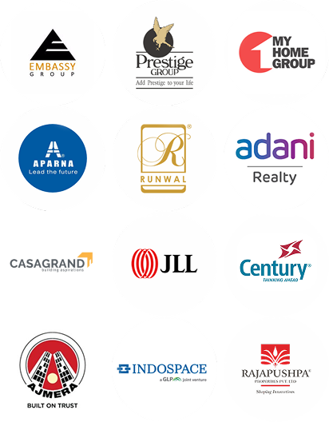
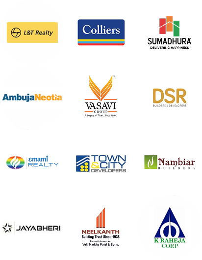
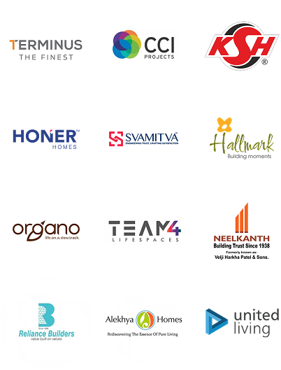
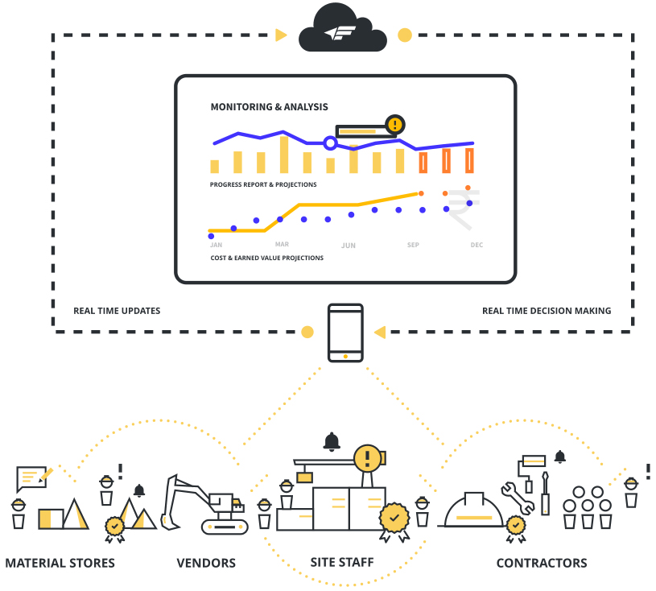
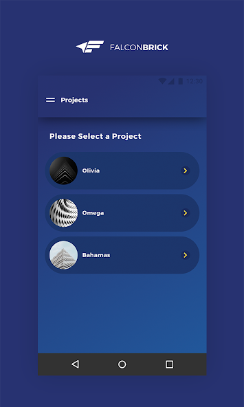
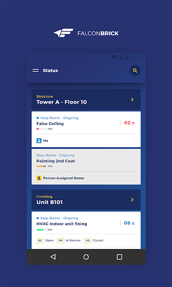
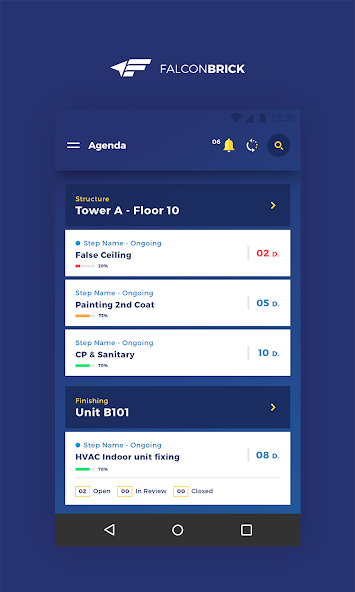
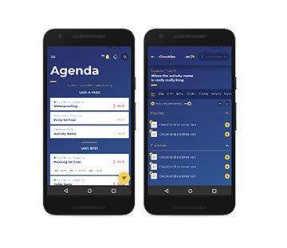
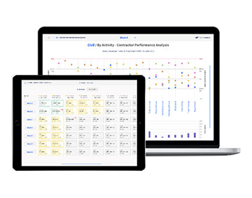

# FalconBrick competitive intelligence

**Prepared for BuildLens · 29 September 2026**  
**Scope:** company, ownership, funding, financials, team/pay, clients, commercial model, public product outline, app/website UX, competitive lessons, and a BuildLens response plan.

> This is an open-source intelligence report. “Verified” means supported by a company page, government/corporate record, app-store listing, or named publication. “Reported” means a credible third party says it. “Estimate” is explicitly modelled here. FalconBrick is private; no public source can reveal every contract, cap-table entry, current licence quote, employee, or product screen.

## Executive readout

FalconBrick Technologies Private Limited is a Bengaluru construction-operations SaaS company incorporated in October 2015. Its three founders are Gautam Mayur, Aditya Shankar, and Sashi Kiran. The company has stayed relatively small—roughly 29–37 people by recent public indicators—while building an unusually strong enterprise client roster and a high-touch Customer Success deployment model.

Its public proposition is not a generic ERP. It is the operational layer between head-office plans and daily site execution: mobile agendas, progress capture, inspections, snags/NCRs, contractor workflows, billing verification, handover, and management analytics. Pricing is quote-only, usage-based, and tied to the amount of construction—per project, apartment/unit, or square foot—with unlimited users. There is no verified public rate card.

The reported FY25 figures are about **₹9.53 crore revenue**, **₹9.55 crore total income**, and **₹4.4 lakh profit before/after tax** (sources disagree on the exact label, but agree on the amount). Revenue grew roughly 21.5% from FY24. No current valuation is publicly disclosed. A defensible, deliberately broad planning estimate is **₹20–45 crore enterprise value**, based on roughly 2–4.7× FY25 revenue for a small, growing, near-break-even vertical SaaS/services business. This is not a transaction valuation and should not be presented as fact.

The same FY25 aggregation reports approximately **₹6.77 crore of assets and negative ₹1.43 crore shareholders’ funds**. Corporate-data providers also show active secured charges, but disagree on the current aggregate (roughly ₹1.2–3 crore depending on source/date). Those balance-sheet signals make any revenue-multiple valuation especially uncertain and mean equity value could be materially below enterprise value.

FalconBrick’s greatest strengths are vertical depth, credibility, configurability, offline operation, unlimited-user adoption, and implementation support. Its clearest exposed weakness is the field app experience: as inspected on 29 September 2026, Google Play showed **3.4/5 from 118 reviews and 10K+ downloads**. Several recent one-star reviews report crashes while entering snags, lost entries, sluggishness, device heating, battery drain, and high data consumption. BuildLens can win by making “never lose field work” a product guarantee, supported by visible offline-sync state, autosaved drafts, resumable uploads, efficient media handling, and transparent recovery.

The FalconBrick website is effective because it sells business outcomes before features, places proof early, speaks to distinct stakeholders and project segments, explains the operational loop visually, and repeats one conversion action. BuildLens should borrow that information architecture—not FalconBrick’s visual identity. BuildLens’s forest/bronze premium system can be stronger if the public website adds credible outcome-led storytelling, an interactive product tour, real screens, and role-based proof.

## Company identity and current scale

| Item | Finding | Confidence |
|---|---|---:|
| Legal entity | FalconBrick Technologies Private Limited | High |
| CIN | U74900KA2015PTC083144 | High |
| Incorporated | 6 October 2015, ROC Bengaluru | High |
| Status | Active, unlisted, private company | High |
| Registered/operating city | Bengaluru, Karnataka | High |
| Founders | Gautam Mayur, Aditya Shankar, Sashi Kiran (Sadagopan Sashikiran in corporate records) | High |
| Current directors in public corporate records | Aditya Shankar, Gautam Mayur, Sashikiran Sadagopan, Abhishek Deepak Bhatewara | High |
| Company size | LinkedIn: 11–50 and 36 visible employees; Inc42: ~37; EPFO-derived secondary source: 29 in April 2024 | Medium–high |
| FY25 reported revenue from operations | ₹9.53 crore | Medium–high |
| FY25 reported total income | ₹9.55–9.60 crore | Medium–high |
| FY25 reported profit | ₹4.4 lakh | Medium–high |
| FY24 total income | ₹7.86 crore | Medium–high |
| Public customer claim | Current homepage: 300+ customers, 600+ projects, 12 cities, 200M+ sq ft | Medium: self-reported and inconsistent across pages |
| Mobile app | Handoff v2.1, Android, 10K+ downloads | High |
| Public app rating observed | 3.4/5, 118 reviews on 29 Sep 2026 | High, point-in-time |

Corporate-record sources: [ZaubaCorp company record](https://www.zaubacorp.com/FALCONBRICK-TECHNOLOGIES-PRIVATE-LIMITED-U74900KA2015PTC083144), [The Company Check](https://www.thecompanycheck.com/company/falconbrick-technologies-private-limited/U74900KA2015PTC083144), and [LinkedIn company page](https://in.linkedin.com/company/falconbrick-technologies). Financial aggregation: [SensiBook FY25](https://www.sensibook.com/companies/2129223/U74900KA2015PTC083144/FALCONBRICK-TECHNOLOGIES-PRIVATE-LIMITED) and [Inc42 financials](https://inc42.com/company/falconbrick/financials/).

### Important consistency warning

FalconBrick’s own pages contain multiple generations of metrics:

- Homepage: 300+ customers, 600+ projects, 12 cities, 200M+ sq ft.
- About page: 120+ builders, 10 cities, 40M sq ft.
- Product-module page: 100+ developers, 150+ projects, 12 cities, 50M+ sq ft.
- A 2025 Construction World interview: 300+ projects across 10 cities.

This probably reflects stale page sections rather than deliberate misstatement, but it weakens auditability. BuildLens should date every scale metric (“as of Q3 2026”) and maintain a single source of truth for website claims.

## Founders and leadership

### Gautam Mayur — co-founder, construction/customer-success orientation

FalconBrick describes Mayur as having deep construction, infrastructure, project-management, and innovation experience, with an ISB background and prior work spanning L&T, Goldman Sachs, Kraft Foods, Saks Fifth Avenue, and Wipro. The public site currently labels his functional area “Customer Success.” His strategic contribution appears to be construction-domain translation and enterprise adoption.

### Aditya Shankar — co-founder, technology/product orientation

FalconBrick describes Shankar as a hands-on technology entrepreneur, product leader, and architect across mobile, web, and backend systems. Corporate records show him as a director from incorporation. The Play Store support contact also uses his FalconBrick email, suggesting continuing operational proximity to the product.

### Sashi Kiran — co-founder/director, consulting/change-management orientation

FalconBrick describes Kiran as an ISB graduate with management-consulting experience focused on construction, infrastructure, and real estate. Interviews and press coverage consistently use him as a spokesperson for the business and commercial model.

### Abhishek Deepak Bhatewara — director/investor/customer connection

Bhatewara is associated with Rohan Builders/Rohan Developers and participated in the 2017 angel financing. Corporate records show him as a FalconBrick director from 2020. This is strategically important: FalconBrick did not merely sell to the industry; it embedded industry operators in its ownership/governance network.

Founder source: [FalconBrick’s team page/beta site](https://falconbrick.com/beta/), [FalconBrick About](https://www.falconbrick.com/about-us/), and [Inc42 people profile](https://inc42.com/company/falconbrick/people/).

## Funding, investors, capital, and valuation

### Disclosed financing

The clearest disclosed round is the March/April 2017 angel round of approximately **₹4 crore** (roughly US$0.5–0.55M at the time). The Economic Times and Inc42 identify:

- Apurva Salarpuria, Salarpuria Sattva
- Sidharth Pansari, Primarc Group
- Vidyut Saraf, Forum Projects
- Satveer Singh Thakral / Singapore Angel Network
- Rahul Talwar
- Abhishek Bhatewara, Rohan Builders
- Dreamweaver Investment & Business Solutions
- Mridul Upreti, then associated with JLL investment leadership
- LetsVenture
- Mumbai Angels
- an unnamed international VC; BEENEXT lists FalconBrick in its portfolio and Indian government FDI tables also associate BEENEXT with the company

Sources: [Economic Times funding report](https://economictimes.indiatimes.com/small-biz/money/bengaluru-based-falconbrick-raises-rs-4-crore-in-angel-round/articleshow/58059651.cms), [Inc42 funding report](https://inc42.com/buzz/falconbrick-angel-funding/), [BEENEXT portfolio archive](https://www.beenext.com/partnership/2017/page/2/), and [DPIIT FDI table](https://www.dpiit.gov.in/static/uploads/2025/07/40074f4c4265be235a2aa4a6a6b572f9.pdf).

Data providers disagree slightly: CB Insights reports $500K over two rounds; YourStory reports $550K total. There is no reliable public evidence of a later priced institutional round.

### Corporate capital and debt signals

Public corporate aggregators report authorized share capital of ₹4 lakh and paid-up capital of ₹1.3 lakh. These accounting figures are not the company’s valuation. Public charge records show historic secured facilities and newer open charges reported at up to ₹3 crore in aggregate. A registered charge is security for an obligation; it is not proof that the full amount is currently drawn.

### Valuation

**Verified public valuation: none found.** No credible public source gives a current post-money or enterprise value.

For internal planning only:

1. FY25 revenue is reported at ₹9.53 crore.
2. Growth from FY24 is approximately 21.5%.
3. Profit is near break-even, and the model appears to include meaningful implementation/customer-success labour.
4. Applying a conservative 2–4.7× revenue range gives approximately **₹19–45 crore enterprise value**.
5. Round this to a practical **₹20–45 crore** working band. Equity value could be lower or higher depending on actual debt, cash, retention, concentration, and recurring-revenue quality.

Do not cite this estimate externally as FalconBrick’s valuation. A real valuation would require the latest cap table, ARR/MRR, gross margin, renewal and expansion rates, client concentration, cash/debt, and share-preference terms.

## Financial profile

The best publicly accessible FY25 aggregation reports:

| Metric | FY23 | FY24 | FY25 |
|---|---:|---:|---:|
| Revenue from operations | ₹6.59cr | ₹7.81cr | ₹9.53cr |
| Other income | ₹19.38L | ₹2.82L | ₹0.30L |
| Total income | ₹6.79cr | ₹7.86cr | ₹9.55cr |
| Employee benefits | ₹3.80cr | ₹3.37cr | ₹4.63cr |
| Depreciation | ₹19.96L | ₹35.79L | ₹83.90L |
| Other expenses | ₹3.02cr | ₹2.76cr | ₹2.76cr |
| Total expenses | ₹8.19cr | ₹7.67cr | ₹9.51cr |
| Profit before tax | -₹1.41cr | ₹19.56L | ₹4.40L |

Interpretation:

- FalconBrick appears to have recovered from an FY23 loss, but FY25 profit is extremely thin.
- Employee benefits were roughly 49% of FY25 revenue, consistent with a service-assisted SaaS model.
- Revenue growth is healthy for a mature small company, but not hypergrowth.
- The model may be capital-efficient, yet implementation/support intensity can constrain pure-software margins.
- A small team serving marquee clients implies strong enterprise leverage but creates key-person and support-capacity risk.
- The same aggregator reports FY25 assets of approximately ₹6.77cr and shareholders’ funds of about **-₹1.43cr**. This suggests accumulated losses or other balance-sheet pressure despite positive FY24–25 profit.
- Public charge databases are not synchronized: current/open secured charges are variously shown at roughly ₹1.2cr, ₹1.5cr, or ₹3cr. Treat the exact debt exposure as an unresolved diligence item, not a settled fact.

## Employees, culture, and pay ranges

### Headcount

- LinkedIn showed 36 visible employees and company size 11–50.
- Inc42 estimated 37.
- An EPFO-derived corporate-data source reported 29 employees as of April 2024.

The most reasonable current working assumption is **30–40 employees**, not hundreds.

### Publicly reported annual pay ranges in India

These are self-reported or job-advertised, small-sample figures—not an official pay scale:

| Role | Reported range |
|---|---:|
| Software Engineer | ₹5–11L |
| Android Developer | ₹9–18.3L |
| Backend Developer job advertisement (3–7 years) | ₹20–30L |
| Product Designer job advertisement | ₹20–30L |
| Customer Success Specialist | ₹10–12L / ₹11.5–12L depending on source |
| Customer Success Manager | ₹9.3–15.1L |
| Client Success Specialist | ₹11–12.3L |
| Customer Success Analyst | ₹8L |
| Technical Support Engineer | ₹6–7L |
| Business Analyst | ₹6–14.6L; Glassdoor single report ₹11L |
| Product Analyst | ₹8–9L |
| Talent Acquisition Specialist | ₹13–15L |
| Customer Acquisition Specialist | ₹22–23L (one report) |

Sources: [Glassdoor salary page](https://www.glassdoor.co.in/Salary/FalconBrick-Technologies-Salaries-E2198748.htm), [AmbitionBox reviews and salary snippets](https://www.ambitionbox.com/reviews/falconbrick-technologies-reviews), [backend-developer listing](https://cutshort.io/job/Backend-Developer-Bengaluru-Bangalore-wrackle-D397pRYS), and [product-designer listing](https://jobs.gohire.io/falconbrick-technoligies-bszwhm97/product-designer-87053/).

### Culture signal

Glassdoor showed 4.8/5 from 16 reviews, whereas AmbitionBox showed 3.4/5 from 7 reviews. The sample sizes are too small and divergent to infer culture confidently. AmbitionBox’s highest category was salary/benefits (3.9); job security was lowest (3.0). Treat review sites as anecdotal.

## Customers, segments, and ecosystem

### Named customers or publicly claimed users

FalconBrick’s current and historical pages, testimonials, case studies, and interviews name the following. A name means a public claim or testimonial, not necessarily a current paid contract in 2026.

**Developers/builders:** Prestige Group, Embassy Group, My Home Group/MyHome Constructions, Aparna Constructions, Runwal Developers, Adani Realty, Casagrand, Salarpuria Sattva, Brigade Group, K Raheja Corp, DLF, Rohan Builders/Developers, PS Group, Srijan Realty, TVS Emerald, Shriram Properties, VBHC, Kolte Patil, Primarc, Rustomjee, Oberoi Realty/Builders, Puravankara, Ozone Group, Orbit Group, Sureka Group, Dosti Realty, M3M, Marathon Group, Panchshil Realty, Goel Ganga, Ambuja Neotia, Vasavi Group, DSR Builders, Town City Developers, Jayabheri, Neelkanth, Rajapushpa, Ajmera, Century, Sreemaa Realty, Terminus, CCI Projects, Hallmark, Organo, Team4, Reliance Builders, Alekhya Homes, and United Living.

**PMCs/consultancies:** JLL, CBRE, Colliers.

**Contractors/EPC:** L&T/L&T Realty/L&T Construction, NCC/Nagarjuna Construction Company, Capacite Infraprojects, Shapoorji Pallonji, Tata Projects; FalconBrick also references contractor workflows for specialist civil/MEP and ready-mix partners.

**Industrial/logistics:** IndoSpace is explicitly named in a case study. Warehousing/logistics is a core segment.

**Industry relationships:** FalconBrick markets itself as a CREDAI technology partner and has historical relationships with CREDAI-MCHI and Youth CREDAI.

Sources: [FalconBrick homepage/FAQ](https://www.falconbrick.com/), [2025 Construction World interview](https://www.constructionworld.in/latest-construction-news/real-estate-news/project-site-staff-find-our-platform-beneficial-and-frictionless/69748), [Construction World 2019 profile](https://www.constructionworld.in/latest-construction-news/real-estate-news/mobile-app-based-construction-management-solution/22790), [product-impact page](https://www.falconbrick.com/product-impact/), and [2017 VCCircle funding/customer report](https://www.vccircle.com/real-estate-tech-startup-falconbrick-raises-angel-round).

### Public client-logo panels







### Strategic reading

The client list is a more important moat than the screen design. FalconBrick built referenceability across developer, PMC, and contractor sides of the same ecosystem. Its investors and early customers overlap, creating warm distribution and credibility. BuildLens should deliberately build a similar flywheel: one flagship developer, one respected PMC, one execution contractor, and one industry body—then publish quantified case studies with each.

## Licensing and commercial model

### What is known

- Cloud SaaS; no CAPEX licence model claimed.
- “Pay as you use/pay as you build.”
- Charged per project and scaled to project size.
- Founders have described charging per apartment/unit or per square foot.
- Unlimited users per project; intentionally not seat-based.
- Configuration, training, deployment, and ongoing Customer Success are part of the offer.
- Quote-led enterprise sale; demo/contact form is the primary conversion path.
- App download alone is insufficient: a company-issued ID/password is required.

Sources: [FalconBrick FAQ](https://www.falconbrick.com/faq/), [Inc42 business-model interview](https://inc42.com/features/falconbrick-real-estate-construction/), and [FalconBrick beta site](https://falconbrick.com/beta/).

### What is not public

No verified current rupee rate, module price, minimum annual commitment, implementation fee, storage allowance, SLA tier, support price, renewal uplift, or enterprise discount was found. Any webpage claiming an exact current licence cost without a proposal/invoice should be treated skeptically.

### Revenue-derived sanity check—not a price quote

Dividing FY25 operating revenue by FalconBrick’s inconsistent self-reported scale produces only rough bounds:

- ₹9.53cr / 300 claimed customers ≈ **₹3.2L per customer-year**;
- ₹9.53cr / 120 older claimed customers ≈ **₹7.9L per customer-year**;
- ₹9.53cr / 600 claimed cumulative projects ≈ **₹1.6L per project-year** only if all 600 were simultaneously billable, which is unlikely.

These figures mix annual revenue with cumulative/stale website counts, multiple projects per customer, implementation services, and unknown contract durations. They are useful only as a procurement sanity check: a typical contract probably sits in the **low-to-mid lakhs of rupees per active project per year**, while large portfolio deployments could be materially higher. The only defensible way to obtain a current licence cost is a written proposal scoped by project size, modules, term, rollout effort, support, storage, integrations, and SLA.

### Competitive pricing lesson for BuildLens

FalconBrick’s unlimited-user structure removes the strongest adoption disincentive on a construction site. BuildLens should not make field collaboration expensive. A better model would be:

- base platform fee per active project;
- usage band based on villas/units or project value/area;
- unlimited field viewers/contributors;
- paid advanced controls for BI, integrations, premium support, document volume, and AI;
- transparent pilot price credited to the annual agreement;
- no surprise implementation fee for standard templates.

## Complete public product outline

The following is the fullest defensible reconstruction from FalconBrick’s website, app listing, case studies, and interviews. It is a public product map—not access to its private tenant portal.

### Product surfaces

1. **Handoff mobile app** for site engineers, supervisors, contractors, QA, CRM/handover, and other field users.
2. **Web monitoring portal** for project managers and senior/head-office management.
3. **Business intelligence/analytics layer** for progress, plan adherence, quality, contractors, and root-cause analysis.
4. **Customer Success/configuration service** that maps spaces, activities, workflows, checklists, roles, and project structure before deployment.

### Core operating model

```text
Head-office plan
  → project / tower / floor / unit / space hierarchy
  → activities + dependencies + role-based workflows
  → daily mobile agenda for each field user
  → work update / photo / checklist / WIR / snag / approval
  → offline queue and synchronization
  → current status as a shared source of truth
  → dashboards, alerts, projections and escalations
  → contractor bill verification and final handover certificate
```



### Functional modules

| Module | Publicly described capability | Likely primary users |
|---|---|---|
| Project structure/configuration | Model projects as spaces, activities, workflows, towers, floors, units, rooms/grids; role-specific configuration | Implementation team, project admin |
| Planning and schedule translation | Convert macro head-office plan into field tasks and sequences; surface required run rate, delay causes, and red flags | Planner, PM, leadership |
| Daily work agenda | Prioritized agenda per user; dynamically updated as work progresses | Engineer, supervisor, contractor |
| Progress/DPR | Activity-level updates, live/timestamped photos, status from company level to unit level, pour cards | Site staff, PM |
| Workflow/approvals | Maker-checker, maker-checker-verifier, checker-fixer; approvals/rejections/comments; enforced activity sequence | Site, QA, contractors |
| Quality inspections | Digital checklists, self-inspection, work-inspection requests, audit trail | QA/QC, engineer, contractor |
| Snag/de-snag and NCR | Raise defects with marked-up photos, assign, rectify, verify, close; root-cause analytics | QA/QC, contractor, CRM |
| Safety | Safety audits/monitoring are marketed, though public detail is thinner than quality | Safety team, PM |
| Contractor performance | Allocate work, receive WIRs, compare timeliness/quality, give feedback | PM, commercial, contractor |
| Contractor/supplier billing | Verify bills against activity-wise completed work; track bills and payment decisions | QS/commercial, engineer |
| Drawings and document control | Common drawing store with version history; document tracking to handover | Design, site, document control |
| Materials/vendor packages | Possible-delay alerts, material/store/vendor coordination, tender-event/package tracking | Procurement, stores, PM |
| Inventory/material movement | A September 2026 employee post markets inventory and material-movement monitoring; public workflow detail remains limited | Stores, procurement, PM |
| Concrete/pour workflow | Pre-pour approvals and system-generated digital pour cards | Civil/QA/RMC teams |
| Alerts/escalations | Milestone alerts, missed-deadline escalation, delay red flags, payment milestone alerts | PM, leadership, CRM |
| Portfolio BI | Multi-project dashboards; drill from portfolio to unit; progress, quality, plan and contractor analytics; export to Excel/PPT/PDF | Senior management |
| Handover/transition | Cross-team punch lists, readiness, unit inspection, customer signature, branded handover certificate | Execution, QA, CRM, facilities |
| Facilities/post-possession | Historical sources say the lifecycle extends to facilities management | Facilities, CRM |
| Access/control | Role-based visibility; unlimited users; partitioned client data claimed | Admin/security |
| Offline field work | Near-zero/zero-connectivity operation with later sync | All field users |
| Geotagging and external drawings | Adani Realty’s 2026 rollout announcement says the quality workflow is geotag-enabled and gives access to current drawings through Autodesk Construction Cloud | QA/QC, site, design |

Primary sources: [FalconBrick product page](https://www.falconbrick.com/construction-project-management/), [product-impact page](https://www.falconbrick.com/product-impact/), [solutions by segment](https://www.falconbrick.com/construction-management-solutions/), [FAQ](https://www.falconbrick.com/faq/), and [Google Play listing](https://play.google.com/store/apps/details?id=com.falconbrick.handoff_v2).

### Public app imagery

The current mobile design uses a dense, dark-blue, hierarchy-first interface. The two dominant views are **Status** and **Agenda**. Both group work by spatial hierarchy (tower/floor/unit), show activity cards, and use small status chips/colour to communicate state.

The first public screen is a project selector, reinforcing that a single field user may work across multiple projects:







The older marketing image exposes a checklist detail screen alongside the agenda:



The public analytics image shows matrix/heatmap-style operational status plus contractor-performance scatter/column analytics:



### UX deductions from public screens

Strengths:

- The field user starts with “what I must do now,” not an abstract dashboard.
- Spatial context is always visible: tower → floor → unit.
- Status and agenda are separated, matching “inspect the truth” vs “take action.”
- Card states make large repeatable unit portfolios scannable.
- Workflow/checklist enforcement is embedded near the activity.
- Head-office analytics use construction-specific matrix views instead of generic charts.
- The project selector is deliberately simple: one image, one project name, one forward action. This reduces navigation choice at the start of a shift.

Weaknesses/opportunities:

- Information density and small type increase cognitive and touch burden outdoors.
- Colour chips appear to carry meaning that may not be accessible to colour-blind users.
- The public screens look visually dated and Android-first.
- The hierarchy consumes vertical space before the user reaches the action.
- No visible sync-confidence, draft-saved, retry, or conflict state is apparent in the screenshots.
- Public analytics emphasize reporting more than decision workflows (“what should I do next?”).
- The three Play Store screenshots show only selection, Agenda, and Status. The listing does not publicly demonstrate snag capture, inspections, drawings, billing, analytics, or offline recovery, so those flows are reconstructed from marketing copy rather than verified screen-by-screen.

## Mobile-app reputation and operational risk

At inspection time, Google Play showed:

- Handoff v2.1
- 10K+ downloads
- 3.4/5 from 118 reviews
- updated 14 August 2026
- developer-declared collection of location and personal information
- developer-declared sharing of personal info, app performance, and device/other IDs with third parties
- encryption in transit
- “data can’t be deleted” in the Play data-safety summary

Recent visible one-star reviews alleged:

- app crashes while entering activity/inspection or snag points;
- entered snag points disappear after a crash;
- slow/freezing behaviour;
- high battery and mobile-data consumption;
- device heating;
- field delays caused by instability.

These are user reports, not independently reproduced defects, but the repetition is strategically meaningful. The listing’s “What’s new” text says performance improvements and bug fixes, suggesting FalconBrick is actively addressing reliability.

### BuildLens’s product promise should be measurable

“Never lose field work” can become a core differentiator:

- local-first draft saved after every field change;
- explicit `Saved on device`, `Queued`, `Syncing`, `Synced`, and `Needs attention` states;
- crash-safe form restoration;
- background resumable photo upload with compression and Wi-Fi policy;
- idempotent APIs and per-record sync ledger;
- user-visible retry and conflict resolution;
- offline checklist templates and cached project structure;
- telemetry budgets for battery, data, startup time, and crash-free sessions;
- export/delete and retention controls presented transparently.

## Website UI/UX teardown

### What FalconBrick does well

1. **Outcome-first hero.** “Accelerated project completions,” “reduced costs,” and “zero defects & rework” appear before module detail.
2. **One unmistakable conversion action.** The yellow Schedule a Demo button persists in navigation and reappears throughout the page.
3. **Proof near the fold.** Customer/project/city/square-foot metrics and enterprise logos quickly lower perceived risk.
4. **Clear stakeholder bridge.** The page explicitly connects an all-in-one mobile app for site staff with live monitoring for management.
5. **Role and segment storytelling.** Residential, commercial, warehousing, interiors, PMC, contractor, senior management, and site staff each receive tailored language.
6. **Visual operating-system explanation.** The site explains how plans become field agendas and return as dashboards, not just a list of features.
7. **Concrete outcomes.** Claims such as delay reduction, quality improvement, contractor accountability, and handover are repeated with testimonials and case studies.
8. **Enterprise reassurance.** Customisation, offline mode, unlimited users, Customer Success, and named clients answer adoption objections.

The measured desktop homepage used white, charcoal/black, and `rgb(255,201,56)` yellow; Source Sans Pro for navigation/action UI; Playfair Display for prominent editorial typography; mostly square/4px-radius controls; generous whitespace; and large photographic/product composites.

### What should not be copied

- Old/stale sections create contradictory metrics.
- The home page is long and repeats blocks/content.
- A visible cookie banner dominates the top of the page on first visit.
- Many images have empty alt text; accessibility is weak.
- Product evidence is often stylized/low-resolution rather than a crisp interactive tour.
- WordPress/plugin structure produces duplicated desktop/mobile content in the DOM and a heavy asset/plugin footprint.
- Quote-only pricing gives buyers no budget anchor.
- “India’s only/#1” claims are not substantiated on-page.
- The website does not confront the app-rating/reliability risk.

## Direct comparison with the current BuildLens codebase

BuildLens already has a strong secure foundation: Next.js UI, FastAPI authorization/business layer, Cloud SQL RLS, immutable audit history, tenant boundaries, and a wide domain schema. The current UI exposes Dashboard, Villas, Work Sections, People, Vendors, Reports, and Documents. The database already anticipates materials, suppliers, purchase orders, allocations/usage, inspections, inspection items, quality issues, snags, task dependencies, progress, delays, vendor performance, drawing revisions, plan versions, and notifications.

| Capability | FalconBrick public maturity | BuildLens current state | Competitive action |
|---|---|---|---|
| Secure multi-tenancy/audit | Claimed but little public technical detail | Strong architectural foundation | Make evidence-grade security/audit a visible selling point |
| Project/villa hierarchy | Mature across tower/floor/unit/space | Project → villa → work → task foundation | Add levels/rooms/grid views and a fast hierarchy switcher |
| Daily field agenda | Core surface | Task APIs/schema, not yet a comparable mobile agenda | Build “Today” as the field home |
| Offline field execution | Core differentiator | Architecture says offline-capable queue; UX not complete | Ship local-first drafts and visible sync states before breadth |
| Progress evidence/photos | Mature | Progress and attachment schema exists | Deliver timestamped evidence, markup, compression, resumable upload |
| Inspections/checklists | Mature | Tables exist; UI/API largely missing | Build templates, inspection runner, approvals, and immutable history |
| Snag/NCR | Mature | Quality issue and snag tables exist | Build a delightful capture → assign → verify → close loop |
| Plans/drawings/versioning | Mature claim | Schema exists; UI/API incomplete | Add revision-aware drawing register and acknowledgement |
| Vendor performance | Mature | Vendor and score schema exists | Link performance to actual completion, rework, safety, and response time |
| Materials/procurement | Expanding/mature claim | Rich schema exists | Expose inventory, PO, delivery, allocation, and usage workflows |
| Billing verification | Publicly supported | Not first-class in current schema/UI | Add measured-work quantities, RA-bill workflow, and approval trail later |
| BI/portfolio | Established | Basic counts only | Start with exception inbox; add portfolio trend/forecast after data quality |
| Handover | Mature | Snags/docs provide ingredients | Create unit readiness score and digital handover pack |
| Customer Success/configuration | Core business capability | Not productized | Build templates/import wizard and an implementation playbook |
| Marketing/proof | Strong enterprise proof | Root route is sign-in only | Create public marketing site; move authentication to `/login` |

## Product lessons and recommended roadmap

### 0–8 weeks: win reliability and daily utility

1. **Field “Today” view:** due/overdue work, inspections, blockers, and recent assignments grouped by villa/zone.
2. **Crash-safe drafts:** persist every form locally; restore automatically.
3. **Sync centre:** visible status, last successful sync, queued item count, retry, conflicts.
4. **Evidence capture:** timestamped photos, optional markup, automatic compression, upload progress.
5. **Inspection runner:** template → checklist → issue → assignment → verification → closure.
6. **Snag flow:** two-tap capture with voice-to-text, location prefilled, severity, owner, due date.
7. **Performance budgets:** crash-free sessions >99.8%, no lost drafts, p95 interaction under 200ms locally, explicit mobile-data budget.

### 2–4 months: make the operational loop complete

1. Dependency-aware activity sequencing and blocked-state explanation.
2. Drawing/version register with revision acknowledgment.
3. Contractor WIR and approval workflow.
4. Vendor scorecards grounded in timeliness, defects, rework, and response SLA.
5. Materials delivery/issue/usage with evidence and variance.
6. Exception inbox for managers: late, blocked, failed inspection, unsynced, missing evidence.
7. Portfolio dashboard that drills company → project → villa → room/activity.

### 4–9 months: differentiated commercial modules

1. Measured-work and contractor bill verification.
2. Pour-card/pre-pour approval template.
3. Handover readiness score, snag burn-down, branded certificate and document pack.
4. Predictive schedule risk based on dependencies and actual production rate—not a vague “AI” claim.
5. Open integration layer for ERP/accounting/scheduling/document systems.
6. Benchmark library using anonymized project data only with explicit governance.

### Strategic positioning

Avoid “FalconBrick but prettier.” Position BuildLens as:

> **The reliable field-to-control-room operating system for residential construction. Every task, inspection, material movement, and handover stays traceable—even when the network disappears.**

Initial beachhead: villa and low-rise residential projects, where BuildLens’s existing model is specific and credible. Expand later to towers and broad EPC use cases. FalconBrick’s breadth took a decade; matching every segment immediately would dilute execution.

## BuildLens website blueprint inspired by FalconBrick

BuildLens currently sends the root route directly to sign-in. The first website change should be architectural: make `/` a public product website and move authentication to `/login`.

### Recommended page order

1. **Navigation:** Product, Solutions, Why BuildLens, Security, Customers, Resources, Pricing approach; `Sign in` secondary; `Book a walkthrough` primary.
2. **Hero:** one outcome-led promise, short proof statement, product UI composition, two actions.
3. **Credibility strip:** pilot/customer logos only with permission; dated metrics; security/uptime badges only when true.
4. **Three outcomes:** protect the programme, eliminate rework, hand over with evidence.
5. **How the loop works:** Plan → Today → Evidence → Verify → Decide.
6. **Role tabs:** Site Engineer, Project Manager, QA/QC, Contractor, Leadership.
7. **Interactive product tour:** real Today, inspection, snag, villa, and control-room screens.
8. **Offline/reliability proof:** sync state, saved draft, resumable media; publish measured numbers.
9. **Module grid:** field execution, quality, drawings, vendors, materials, reporting, handover.
10. **Case study:** one project, baseline, rollout, quantified result, named quote.
11. **Security:** tenancy, RLS, permissions, audit, encryption, retention, backups.
12. **Commercial clarity:** explain per-active-project/unlimited-field-user model and pilot approach even if exact enterprise price is quoted.
13. **Final CTA:** role-aware demo form with only essential fields.

### Visual direction for BuildLens

Keep BuildLens’s forest, warm ivory, and bronze palette and its premium serif/sans pairing. Borrow FalconBrick’s contrast and cadence:

- use large white space and one strong accent for action;
- alternate editorial story sections with dense real-product evidence;
- use architectural lines/grids and site photography as texture, not generic stock collages;
- prefer real annotated screens at readable scale;
- show construction hierarchy through an interactive project navigator;
- use outcome counters only when sourced and dated;
- make mobile screenshots full-size enough to read;
- maintain WCAG AA contrast, proper alt text, keyboard navigation, and reduced-motion support.

### Example hero copy

**Construction work that never disappears.**  
Run villas, contractors, inspections, materials, and handover from one traceable system—online or offline.

Primary action: **Book a project walkthrough**  
Secondary action: **Explore the field workflow**

Supporting proof should be factual, e.g. “Built with tenant isolation, role-scoped access, and immutable audit history,” rather than an unverified “#1” claim.

## Defensible differentiation bets

1. **Reliability as a feature:** publish crash-free sessions, sync success, and lost-draft count.
2. **Audit-grade truth:** show who changed what, when, where, and against which drawing/checklist revision.
3. **Decision-first analytics:** every chart leads to an owner/action, not just export.
4. **Fast implementation:** prebuilt villa/low-rise templates, spreadsheet import, and guided mapping.
5. **Commercial openness:** unlimited field users and an understandable project-based price structure.
6. **Modern privacy:** data export/deletion, retention policy, tenant controls, and a clear data-processing statement.
7. **Superior field ergonomics:** large touch targets, outdoor contrast, voice capture, one-hand use, and low-data media.
8. **Narrow vertical excellence first:** dominate villa/residential workflows before claiming every construction segment.

## Risks and open questions to validate through sales intelligence

The following could not be verified publicly and should become interview/procurement questions, not assumptions:

- current licence rate and minimum contract value;
- net revenue retention, churn, and implementation duration;
- current paying-client count versus cumulative customers;
- revenue concentration among top five clients;
- actual gross margin and proportion of services revenue;
- mobile stack, offline architecture, hosting regions, uptime/SLA, security certifications, backups, and incident history;
- ERP/scheduling integrations and API maturity;
- contractual ownership of customer/project data and deletion process;
- current cap table, option pool, liquidation preferences, debt drawn, and cash position;
- iOS availability and supported device/OS policy;
- whether the 2026 Play reviews reflect one client rollout/device family or system-wide issues.

Recommended ethical methods: customer interviews, ex-user interviews, publicly available RFPs, product demos using a clean competitor-evaluation persona, app-store monitoring, job descriptions, conference talks, and win/loss notes. Do not misrepresent identity, seek confidential data, or induce employees/customers to breach obligations.

## Source index

### Primary/company/product

- [FalconBrick homepage](https://www.falconbrick.com/)
- [Product](https://www.falconbrick.com/construction-project-management/)
- [Solutions by segment](https://www.falconbrick.com/construction-management-solutions/)
- [Product impact](https://www.falconbrick.com/product-impact/)
- [FAQ and commercial model](https://www.falconbrick.com/faq/)
- [About](https://www.falconbrick.com/about-us/)
- [Case studies](https://www.falconbrick.com/case-study/)
- [Google Play: Handoff v2.1](https://play.google.com/store/apps/details?id=com.falconbrick.handoff_v2)
- [LinkedIn company page](https://in.linkedin.com/company/falconbrick-technologies)
- [Adani Realty 2026 quality-management rollout announcement](https://www.linkedin.com/posts/omkar-bendre-33aab25_motivation-leadership-quality-activity-7443289903108567040-QG22)
- [September 2026 FalconBrick capability/client post](https://www.linkedin.com/posts/vivvek-saha-35014620b_falconbrick-constructiontech-contech-activity-7483119501321023489-c4eW)
- [BEENEXT portfolio archive](https://www.beenext.com/partnership/2017/page/2/)

### Corporate, financial, people, and pay

- [ZaubaCorp corporate record](https://www.zaubacorp.com/FALCONBRICK-TECHNOLOGIES-PRIVATE-LIMITED-U74900KA2015PTC083144)
- [The Company Check](https://www.thecompanycheck.com/company/falconbrick-technologies-private-limited/U74900KA2015PTC083144)
- [SensiBook FY25 financial aggregation](https://www.sensibook.com/companies/2129223/U74900KA2015PTC083144/FALCONBRICK-TECHNOLOGIES-PRIVATE-LIMITED)
- [Inc42 FY25 financial profile](https://inc42.com/company/falconbrick/financials/)
- [Inc42 people profile](https://inc42.com/company/falconbrick/people/)
- [Glassdoor salaries](https://www.glassdoor.co.in/Salary/FalconBrick-Technologies-Salaries-E2198748.htm)
- [AmbitionBox reviews/salary excerpts](https://www.ambitionbox.com/reviews/falconbrick-technologies-reviews)

### Funding and independent coverage

- [Economic Times: ₹4 crore angel round](https://economictimes.indiatimes.com/small-biz/money/bengaluru-based-falconbrick-raises-rs-4-crore-in-angel-round/articleshow/58059651.cms)
- [Inc42: angel round](https://inc42.com/buzz/falconbrick-angel-funding/)
- [Inc42: company/product/business-model feature](https://inc42.com/features/falconbrick-real-estate-construction/)
- [Construction World: 2025 founder interview](https://www.constructionworld.in/latest-construction-news/real-estate-news/project-site-staff-find-our-platform-beneficial-and-frictionless/69748)
- [Construction World: 2019 product profile](https://www.constructionworld.in/latest-construction-news/real-estate-news/mobile-app-based-construction-management-solution/22790)
- [YourStory company profile](https://yourstory.com/companies/falconbrick)
- [YourStory founder story](https://yourstory.com/2019/06/watch-saas-startup-transparency-construction)
- [VCCircle funding report](https://www.vccircle.com/real-estate-tech-startup-falconbrick-raises-angel-round)

## Bottom line

FalconBrick proves that construction SaaS adoption is won in the last mile: field agendas, offline operation, site-specific configuration, implementation support, and credible industry relationships. Its marketing turns those operational details into executive outcomes and surrounds them with social proof.

BuildLens should copy the discipline, not the surface. The most promising wedge is a modern, villa-first operating system that is measurably more reliable on site, more transparent about data and pricing, and stronger at turning exceptions into accountable action. The existing BuildLens schema already contains much of the domain foundation; the priority is to expose it through a coherent field loop and then market that loop with real evidence.
